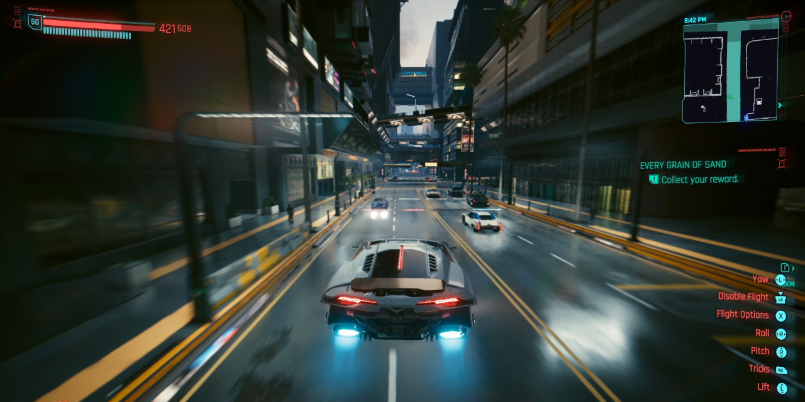

# Let There Be Flight

[](https://github.com/jackhumbert/let_there_be_flight/actions/workflows/build.yaml)

This is a mod for Cyberpunk 2077 that adds a flying mechanism to all cars, with a couple different modes and options.

Other features include:
* Imminent explosion audio indicator
* Visual explosions happen more readily with other cars
* Quick-eject in flight mode (hold exit)

[Video preview of the Drone/Acrobat mode](https://www.youtube.com/watch?v=U9t2JWMY1-k)



## Installation

[Releases are available here](https://github.com/jackhumbert/let_there_be_flight/releases) - If you're upgrading, check the release notes for special instructions.

## Dependencies

* [RED4ext](https://github.com/WopsS/RED4ext) 1.29.0+
* [TweakXL](https://github.com/psiberx/cp2077-tweak-xl) 1.11.0+
* [ArchiveXL](https://github.com/psiberx/cp2077-archive-xl) 1.27.0+
* [Input Loader](https://github.com/jackhumbert/cyberpunk2077-input-loader) v0.2.3+
* [Redscript](https://github.com/jac3km4/redscript) 0.5.31+
* [Mod Settings](https://github.com/jackhumbert/mod_settings) v0.2.21+ (optional)

## Configuration

[`red4ext/let_there_be_flight/inputs.xml`](https://github.com/jackhumbert/let_there_be_flight/tree/main/src/input_loader/let_there_be_flight.xml) contains all the keybindings for the keyboard & controller - you can customize these to your liking. See all possibilities here: https://nativedb.red4ext.com/EInputKey

Other settings can be found in `red4ext/plugins/let_there_be_flight/packed.reds` for the time being - search for `FlightSettings.SetFloat` to see all the variables used by the mod.

### Restricting flight to certain vehicles

**Mod Settings > Let There Be Flight > General Flight Settings > Flight Availability** decides which vehicles you are allowed to fly. No redscript needed.

| Mode | What can fly |
|---|---|
| All Vehicles | Everything, the default and the behaviour of every earlier version. |
| Owned Vehicles | Your summoned vehicle, plus any vehicle whose record is unlocked in your garage (bought, quest rewards, gifts). Note this goes by record, so an identical model spawned by traffic also counts. |
| Player Vehicle Only | Only the vehicle the game marks as yours, i.e. the one you summon. |
| Whitelist Only | Only the vehicle records you list yourself, see below. |

The setting applies live, and it only gates what you can fly: every vehicle still gets its flight component, so nothing about how other vehicles look or drive changes. In a restricted mode the flight toggle does nothing on a vehicle that is not allowed, its input hint is not shown, and the flight quickhacks are not offered for it.

For **Whitelist Only**, create a file called `r6/tweaks/my_flight_whitelist.yaml` (any name works, it just has to be in `r6/tweaks` and end in `.yaml`) and list one record per vehicle:

```yaml
Vehicle.v_sport2_quadra_type66_player:
  canEnterFlight: true

Vehicle.v_sport1_rayfield_caliburn_player:
  canEnterFlight: true

Vehicle.v_sportbike2_arch_jackie_player:
  canEnterFlight: true
```

The record names are the same `Vehicle.<name>` ids used elsewhere in TweakDB; [`src/tweaks/vehicles.tweak`](https://github.com/jackhumbert/let_there_be_flight/tree/main/src/tweaks/vehicles.tweak) lists most of the player-ownable ones. The opposite flag, `flightDisabled: true`, blacklists a vehicle in every mode and is documented in [`src/tweaks/vehicleFlight.tweak`](https://github.com/jackhumbert/let_there_be_flight/tree/main/src/tweaks/vehicleFlight.tweak).

### Per-vehicle configuration classes

Vehicles can be customized via extending the `IFlightConfiguration` class (should not be extended directly if you don't know what you're doing - use `CarFlightConfiguration`, `SixWheelCarFlightConfiguration`, or `BikeFlightConfiguration`). As an example, the below disables flight for all vehicles except the Jen Rowley Type 66:

```swift
public class CustomCarFlightConfiguration extends CarFlightConfiguration {
  public func CanActivate() -> Bool = false;
}

public class CustomSixWheelCarFlightConfiguration extends SixWheelCarFlightConfiguration {
  public func CanActivate() -> Bool = false;
}

public class CustomBikeFlightConfiguration extends BikeFlightConfiguration {
  public func CanActivate() -> Bool = false;
}

public class FlightConfiguration_quadra_type66__basic_jen_rowley extends CarFlightConfiguration {
  public func CanActivate() -> Bool = true;
}
```

## Compatibility

Known interactions with other mods, checked against the mod sources where they are public. "Reported" means Nexus user reports only, not verified here.

- Dark Future: works with LTBF 0.3.18 and later. Older LTBF versions replaced `VehicleEventsTransition.HandleCameraInput` with `@replaceMethod`, which collided with the same replacement in Dark Future's `DFVehicleSleepSystem.reds` and failed redscript compilation. LTBF now wraps that method instead. If you still see a compile error naming `HandleCameraInput`, update LTBF.
- Limited HUD: reported to work again with current versions of both mods. The Nexus description that lists it as incompatible is out of date.
- Project E3 HUD: reported layout overlap with the flight HUD. Not verified; turn off the flight UI in Mod Settings if the two collide.
- Night City Alive, Night City Allies, Car Modification Shop, Vehicle Navigation System, Enhanced Vehicle System, Need More Smoke FX: no public source to check and no specific conflicting function named in reports. Not verified either way.

LTBF replaces these base game methods, so any other mod that also replaces one of them will fail to compile: `VehicleComponent.OnVehicleWaterEvent`, `VehicleObject.SendQuickhackCommands`, and `OnVehicleStateChanged` on `VehicleCombatContextDecisions`, `VehicleDriverCombatContextDecisions` and `VehicleDriverContextDecisions`.

## Troubleshooting

To better report crashes, click on "What does this report contain?" in the crash handler window:


And find the Cyberpunk2077.dmp file, shown here:


Copy this file, along with your `red4ext/logs/ctd_helper.log` file *before* you run the game again - it will get overwritten on each launch:


If you can include both of these files in any report, it should make it a lot easier to track down bugs.

## Translating

The en-us localization dictionary can be seen in /wolvenkit/source/raw/user/jackhumbert/localization/let_there_be_flight.en-us.json.json - this is a JSON-formatted file. To create a new translation, copy this file, and adjust all of the `femaleVariant` values. Please use the standard language tag (like 'en-us', 'fr-fr', etc) as the file name. You can send this to me and I'll include it with LTBF, or you can host it yourself on Nexus, etc.

If you want to distribute your own language pack for LTBF, you'll need to use Wolvenkit convert & pack this into an `.archive` file (please name this file using the language tag, like this: `let_there_be_flight.fr-fr.archive`), which needs to be paired with a `let_there_be_flight.fr-fr.archive.xl` file to be read correctly by Archive-XL. Example contents are below:

```yaml
localization:
  onscreens:
    fr-fr: user\jackhumbert\localization\let_there_be_flight.fr-fr.json
```

You'll need to replace all `fr-fr` instances with your language code.


## Uninstallation

Run `red4ext/plugins/let_there_be_flight_uninstall.bat` (it ships in the zip, next to the plugin folder). It deletes every LTBF file and the plugin folder, then itself; the dependencies (RED4ext, ArchiveXL, TweakXL, redscript, Input Loader, Mod Settings) are left alone.

To uninstall by hand instead, delete these from the game folder, which is everything the mod installs:

```
red4ext/plugins/let_there_be_flight/            (the whole folder)
    let_there_be_flight.dll
    let_there_be_flight.archive
    let_there_be_flight.archive.xl
    let_there_be_flight.tweak
    let_there_be_flight.yaml
    packed.reds
    module.reds
    inputs.xml
    base_sounds.bank
    base_sounds.strings.bank
    fmod.dll
    fmodstudio.dll
    readme.md
    license.md
red4ext/plugins/let_there_be_flight_uninstall.bat
```

Mod settings values saved by Mod Settings live in its own files, not in the LTBF folder.

## Development

These are some of the steps I take to update the mod for new versions of the game - it involves some manual address looking-up using IDA, a custom version of Zoltan, and my fork of RED4ext.SDK:

1. Merge deps/red4ext.sdk from upstream
1. Update all addresses with "1.61hf1 RVA:" (that matches latest game version) in RED4ext.SDK
  1. Patterns & hints for each addresss should be in each file
  1. Addresses that don't have the current version likely aren't used by LTBF
1. Run "Generate Addresses" in the VS Code project
1. Update the game option addresses in src/red4ext/FlightSystem.cpp
1. Update RED4ext.SDK VFTs
  1. Uncomment the VFT finder in src/red4ext/FlightSystem.cpp:L192
  1. Run the game until it crashes (expected)
  1. Copy the `#define`s from red4ext/logs/let_there_be_flight.log to deps/red4ext.sdk/include/RED4ext/Addresses_VFT.hpp

Helpful state machine viewer: https://cyberpunk.ldlework.com/

Special thanks to @psiberx for [Codeware Lib](https://github.com/psiberx/cp2077-codeware/), [InkPlayground Demo](https://github.com/psiberx/cp2077-playground), and Redscript & CET examples on Discord, @WopsS for [RED4ext](https://github.com/WopsS/RED4ext), @jac3km4 for [Redscript toolkit](https://github.com/jac3km4/redscript), @yamashi for [CET](https://github.com/yamashi/CyberEngineTweaks) and the [E-mode mod](https://www.nexusmods.com/cyberpunk2077/mods/3207?tab=description) (very helpful in figuring out how to work with FMOD), @rfuzzo & team (especially @seberoth!) for [WolvenKit](https://github.com/WolvenKit/WolvenKit), and all of them for being helpful on Discord.

Interested in adding flying vehicles or a similar mechanic to an existing game? Let me know!

Audio system made with [FMOD Studio](https://www.fmod.com/) by Firelight Technologies Pty Ltd.
